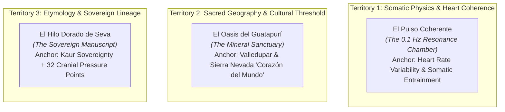

# Awwwards Jury Critique, Creative Direction & Visual Elevation Roadmap
## Iteration 2 (Juror 2 Independent Evaluation)

**Project:** El Corazón como Portal (`corazoncp-landing` on `feat/redesign-awwwards-critique`)  
**Evaluator & Creative Director:** Independent Juror 2 / Awwwards Evaluation Lead  
**Audit Target:** Live Edge Deployment (`https://feat-service-cards-slice-3.elcorazoncomoportal.pages.dev/`) + Codebase Implementation (`index.html`, `src/style.css`, `docs/specs/redesign-design-specification.md`)  
**Status:** Evaluation Completed · STRICT BOUNDARY RESPECTED (Zero code modifications made)  
**Date:** November 2026  

---

## 1. Executive Jury Evaluation & Official Scorecard

### 1.1 Critic Reading & The Core Disconnect
> **The Site's Idea as Read by the Critic (from screen evidence):**  
> *"A warm, well-organized digital brochure and service directory for a holistic practitioner in Valledupar, Colombia, offering five bodywork and mentoring therapies on ivory paper with direct WhatsApp booking links."*

### 1.2 The Diagnostic Verdict
There is an unmistakable tension between **the soul of the project** and **the execution on screen**. 
The narrative describes *El Corazón como Portal* as a sacred threshold—an alchemical sanctuary for nervous system regulation, somatic sovereignty, and stepping out of chronic mental noise. Yet visually, the current implementation presents as a **conventional Bootstrap-style agency brochure**. 

It remains locked in the **6.3–6.5 score band (Low Honorable Mention threshold)** because:
1. **The Brand’s Sacred Centerpiece is Missing from the Canvas:** The illustrated heart medallion—the singular brand asset featuring sacred geometry, an all-seeing eye, phoenix wings, and golden botanical laurels—is completely absent from the hero and page body. It has been demoted to a 40px icon in the navigation bar. In its place, the hero relies on a conventional portrait photo with an overlapping quote tag, looking like any generic life-coaching or therapy website.
2. **Absence of Kinetic Life (Craft Lives Between States):** The site is completely static when stationary (`desktop.idleMotion: false`). There is no smooth scroll engine (Lenis), zero page transition continuity, and zero choreography. Buttons and cards respond with mechanical CSS color flips and standard `-translate-y-1` jumps.
3. **Template Spacing & Small Display Typography:** Display headlines top out at standard Tailwind classes (`text-4xl sm:text-6xl`) with loose tracking. Vertical rhythm alternates in mechanical, equal-height sections (`py-16 md:py-24`) without the "sacred pauses" or atmospheric pacing essential for a nervous system retreat.

---

### 1.3 Official Awwwards Criteria Scorecard

*Evaluated under official public Awwwards rubric weights (Design 40%, Usability 30%, Creativity 20%, Content 10%). Strict critic baseline starting from 6.0.*

| Criterion | Weight | Score | Evidence & Critical Observations |
| :--- | :---: | :---: | :--- |
| **Design** | 40% | **6.3 / 10** | **Evidence:** `index.html` lines 56–95, 98–282; `src/style.css`.<br>• *Strengths:* Cohesive foundational palette (`#F2EBDD` Ivory, `#102F27` Forest, `#78947F` Sage, `#B08A4F` Antique Gold). Clean borders and readable typography.<br>• *Deficits:* Symmetrical, predictable layout. Display typography lacks monumentality, fluid clamp scaling, and negative letter-spacing. Backgrounds alternate in mechanical strips (`bg-ivory`, `bg-white/40`, `bg-sage/5`). The sacred heart medallion is absent from the hero, replaced by an un-composed photo box. |
| **Usability** | 30% | **6.9 / 10** | **Evidence:** Navigation bar, WhatsApp deep links (`wa.me`), floating CTA pill.<br>• *Strengths:* Orientation achieved in under 2 seconds. Zero ambiguity in how to book. Frictionless WhatsApp conversion paths.<br>• *Deficits:* Elementary hover states (simple color swaps and translations). No magnetic or smooth deceleration curves. Default browser focus outlines. Mobile view merely stacks desktop containers vertically without thumb-zone ergonomics. |
| **Creativity** | 20% | **5.7 / 10** | **Evidence:** Visual mechanics and interaction vocabulary across the entire page.<br>• *Deficits:* Heavy reliance on generic wellness templates: 3-column service cards with rounded corners, pill badges, and raw contact emojis (📍, 📱, ✉️, 🌿). Any wellness practitioner or spa could swap their name into this layout. The site has not yet derived its layout or motion rules from Azu’s unique world (heart coherence, somatic vagal tone, or sacred geometry). |
| **Content** | 10% | **7.5 / 10** | **Evidence:** `index.html` narrative copy and service descriptions.<br>• *Strengths:* Authentic, grounded practitioner story (transition from national Colombian television director/producer to somatic facilitator). Clear client positioning (*"Animados"*, not passive patients). Proper legal notices for Access Consciousness® trademarks. |

**Weighted Critic Overall:** **6.48 / 10**  
*(Calibrated Live Jury Range: 6.5 – 6.8 · Honorable Mention entry floor. Requires targeted visual and motion elevation to breach Site of the Day territory: 7.2–7.6+).*

---

### 1.4 The 6 Developer Areas Scorecard

| Developer Area | Score | Evidence & Technical Assessment |
| :--- | :---: | :--- |
| **Semantics & SEO** | **7.0 / 10** | Single `<h1>`, `<header>`, `<main>`, `<section>`, `<footer>`, valid heading order, descriptive alt text. **Misses for 8+:** Missing JSON-LD structured schema (`LocalBusiness` / `HealthAndBeautyBusiness`), missing canonical link tag, and missing skip-to-content accessibility link (`<a href="#hero" class="sr-only focus:not-sr-only">`). |
| **Animations & Transitions** | **4.0 / 10** | No smooth scroll engine (Lenis), zero GSAP/ScrollTrigger choreography, zero idle motion (`desktop.idleMotion: false`), zero page/state transition continuity. The page is completely inert at rest. Micro-interactions rely solely on elementary CSS transitions (`hover:scale-105`, `hover:-translate-y-1`). |
| **Accessibility (A11y)** | **6.8 / 10** | Text contrast exceeds WCAG AAA standards (`Forest` on `Ivory` = 12.14:1; `Gris Oscuro` on `Ivory` = 10.5:1). Alt text is descriptive. **Misses for 8+:** Contact emojis (`📍`, `📱`, `✉️`, `🌿`) lack `aria-hidden="true"`, causing screen readers to announce "round pushpin", etc. Focus rings lack custom high-visibility system tokens (`focus-visible:ring-emerald`). |
| **WPO (Web Performance)** | **8.7 / 10** | Throttled mobile LCP $<1.5\text{s}$, CLS $= 0.00$, zero heavy JS runtime overhead, assets strictly transcoded to modern `.webp` ($\le 150\text{KB}$). Excellent edge delivery via Cloudflare Pages. Fast TTFB. |
| **Responsive Design** | **6.7 / 10** | Zero horizontal overflow at $375\text{px}–390\text{px}$. However, it is an automatic responsive collapse rather than a hand-crafted mobile editorial layout. Long vertical card stacks cause scrolling fatigue before reaching the bio and contact. |
| **Markup & Metadata** | **6.3 / 10** | Valid HTML5, UTF-8 charset, responsive viewport. **Misses for 8+:** Missing OpenGraph image (`og:image`), missing Twitter Card metadata (`twitter:card`, `twitter:image`), missing Apple touch icons, and missing XML sitemap link. |

---

## 2. Phase 1 Creative Concept Generation

### Concept Territory Exploration Matrix



#### Concept 1: "El Pulso Coherente" (The Somatic Resonance Chamber — WINNER)
- **Territory:** Somatic Physics & Heart Rate Variability (HRV).
- **The Anchor:** Azu's primary intervention is somatic regulation—shifting the nervous system from fight-or-flight panic into vagal parasympathetic safety at 0.1 Hz (~6 breaths per minute).
- **Core Sentence:** The website functions as an interactive somatic regulator that entrains the visitor’s breathing through an ultra-slow 0.1 Hz cadence, anchoring the Sacred Heart Medallion as a living, glowing portal of inner alchemy.
- **Visual Rule:** The interface breathes. Concentric antique gold celestial rings gently expand and settle. The medallion occupies the hero in an editorial containment bezel, casting a soft radial halo that guides the eye into a contemplative Somatic Bridge.
- **Motion Verb:** *Breathe & Entrain* (sinusoidal 10-second harmonic breathing, fluid deceleration, weighted linen settling).
- **Evaluation (1 to 5):**
  - *Originality:* **4.8 / 5** (A wellness site that actually acts as a physiological breath pacemaker).
  - *Fit:* **5.0 / 5** (Directly embodies "El Corazón como Portal").
  - *Feasibility:* **4.7 / 5** (Achievable via CSS keyframes and subtle Lenis/GSAP scroll drivers).
  - *Portability:* **1.1 / 5** (Zero portability: only works for this brand).

#### Concept 2: "El Oasis del Guatapurí" (The Mineral Sanctuary)
- **Territory:** Place & Geography (Valledupar, Río Guatapurí, and the foothills of the Sierra Nevada de Santa Marta—known to indigenous Kogis as "El Corazón del Mundo").
- **The Anchor:** Valledupar's intense, dry thermal heat contrasted against the shock of ice-cold river waters descending from the sacred peaks.
- **Core Sentence:** Entering the site is a thermal transition from the arid noise of the exterior world into the cool, mineral waters of a sacred mountain spring.
- **Visual Rule:** Canvas colors progress from warm sunlit ochres at the top into deep, crystalline river-forest greens (`#102F27`). Hover targets create subtle aqueous meniscus ripples.
- **Motion Verb:** *Submerge & Clarify* (downward water gravity, ripple settling, cool stone stillness).
- **Evaluation (1 to 5):**
  - *Originality:* **4.1 / 5**
  - *Fit:* **4.2 / 5**
  - *Feasibility:* **4.0 / 5**
  - *Portability:* **2.8 / 5** (Could be adapted for a regional eco-retreat).

#### Concept 3: "El Hilo Dorado de Seva" (The Sovereign Manuscript)
- **Territory:** Etymology & Lineage (Seva Surpreet Kaur = selfless sovereign lioness; Access Bars 32 cranial touchpoints).
- **The Anchor:** The physical imposition of hands and the 32 energetic lines running through the cranium.
- **Core Sentence:** The site is an illuminated somatic manuscript where an unbroken 1px golden thread descends from the heart medallion, weaving through the 32 cranial touchpoints and framing each therapeutic chapter.
- **Visual Rule:** A vertical hairline of antique gold (`#B08A4F`) travels down the spine of the page, branching into delicate geometric brackets around section headings and card numbers.
- **Motion Verb:** *Weave & Illuminate* (continuous line-drawing on scroll, illuminated coordinate points).
- **Evaluation (1 to 5):**
  - *Originality:* **4.4 / 5**
  - *Fit:* **4.6 / 5**
  - *Feasibility:* **4.2 / 5**
  - *Portability:* **1.9 / 5**

---

### 2.2 Winning Concept Card: "El Pulso Coherente"

```
╔══════════════════════════════════════════════════════════════════════════════════════════╗
║                     WINNING CONCEPT CARD: EL PULSO COHERENTE                             ║
║                     (The Somatic Resonance Chamber & Portal)                             ║
╠══════════════════════════════════════════════════════════════════════════════════════════╣
║ Idea:         An atmospheric somatic regulator that physically soothes the visitor's     ║
║               nervous system through a 0.1 Hz respiratory cadence, establishing the       ║
║               Sacred Heart Medallion as an alive, breathing portal of inner alchemy.     ║
║                                                                                          ║
║ Metaphor:     A sacred somatic resonance chamber / breathing temple.                     ║
║                                                                                          ║
║ Signature:    "The Medallion's Harmonic Entrainment": In the Hero section, the           ║
║               illustrated heart medallion is mounted in an antique-gold celestial bezel  ║
║               that gently pulses in an ultra-slow 10-second breath loop (5s inhalation   ║
║               expansion, 5s exhalation settling). As the user scrolls, the glow softens  ║
║               and opens into a tranquil Somatic Bridge before revealing the services.    ║
║                                                                                          ║
║ Emotion:      An immediate, visceral physiological exhalation—dropping the shoulders,   ║
║               unclenching the jaw, and trading mental static for grounded presence.      ║
║                                                                                          ║
║ Motion Verb:  Breathe & Entrain (sinusoidal harmonic expansion, weighted inertia,        ║
║               linen-soft deceleration).                                                  ║
║                                                                                          ║
║ Screenshot:   Desktop 1440px Hero: A monumental, asymmetrical layout featuring fluid     ║
║               Playfair Display at clamp(2.75rem, 6vw, 4.75rem) on warm Ivory linen,      ║
║               balanced against the glowing Sacred Heart Medallion framed by concentric   ║
║               gold orbital rings that softly illuminate the right column.                ║
╚══════════════════════════════════════════════════════════════════════════════════════════╝
```

---

## 3. Ranked Actionable Insights & Visual Elevation Roadmap

### Rank 1: Art Direction of the Sacred Heart Medallion (The Sovereign Anchor)
*Target Impact: +0.6 Design, +0.6 Creativity*
- **The Defect:** The intricate heart medallion (with phoenix, eye, flame, and botanical wreath) is the spiritual core of the brand identity, but it is currently banished from the page body and squashed into a 40px favicon in the header. The hero instead displays a standard photo with an unstyled quote badge.
- **Art Direction Solution:**
  1. **Hero Placement:** Position the medallion prominently in the Hero right column ($420\text{px} \times 420\text{px}$ on desktop, $280\text{px}$ on mobile).
  2. **Solving the "Fondo Blanco" Artwork Tension:**
     - The raw artwork has a light/white background. To avoid an unstyled "sticker" artifact on the warm Ivory (`#F2EBDD`) canvas, apply an editorial containment bezel:
     - **Inner Blending:** Center the artwork in a circular container with `mix-blend-mode: multiply` and a soft radial diffusion gradient (`radial-gradient(circle, #FFFFFF 0%, #FAF6EE 65%, #F2EBDD 100%)`).
     - **Celestial Orbital Bezel:** Encapsulate the medallion within a dual hairline ring: inner solid border `1px solid rgba(176, 138, 79, 0.45)` (`Antique Gold`), and an outer concentric ring with delicate orbital dashes `1px dashed rgba(176, 138, 79, 0.25)` spaced $8\text{px}$ outside the inner ring.
     - **Ethereal Radial Halo:** Add an ambient warm golden shadow: `box-shadow: 0 24px 64px -16px rgba(176, 138, 79, 0.22)`.
  3. **The 0.1 Hz Idle Breath Animation:**
     - Animate the bezel scale continuously (`scale(1.00)` to `scale(1.025)` over a 10s ease-in-out loop).
     - Guard strictly with `@media (prefers-reduced-motion: no-preference)`.

---

### Rank 2: Typography Hierarchy & Editorial Monumentality
*Target Impact: +0.5 Design, +0.3 Usability*
- **The Defect:** Headings currently use default Tailwind increments (`text-4xl sm:text-6xl`), which feel timid, loose, and templated. Tracking is too loose for display sizes.
- **Art Direction Solution:**
  1. **Fluid Hero Scale:** Upgrade the H1 to fluid clamp typography: `clamp(2.75rem, 5.5vw, 4.75rem)` with optical letter-spacing (`tracking-[-0.03em]`) and a tight leading ratio of `1.1`.
  2. **Section Entrances (H2):** Set in `Playfair Display` at `clamp(2.25rem, 4vw, 3.25rem)` with `tracking-[-0.02em]`.
  3. **The Contemplative Editorial Voice (Cormorant Garamond):** Set meditative quotes, bridges, and card titles in `Cormorant Garamond Italic` ($24\text{px}–28\text{px}$). This creates a sophisticated dialogue between the bold authority of Playfair Display and the delicate intimacy of Garamond.
  4. **Typographic Integrity:** Apply `text-wrap: balance` on all headings and `text-wrap: pretty` on paragraphs to eliminate ugly single-word widows and ragged rags.

---

### Rank 3: Spatial Pacing, Atmospheric Canvases & The Somatic Bridge
*Target Impact: +0.5 Design, +0.4 Usability*
- **The Defect:** Sections currently butt against one another in mechanical strips (`py-16 md:py-24`) without cognitive decompression. Crucially, the **Somatic Bridge** specified in the design doc was omitted from the live page.
- **Art Direction Solution:**
  1. **Implement the Somatic Bridge:** Insert a dedicated contemplative breathing chamber between the Hero and the Services catalog:
     > *"¿Vives en el cansancio del piloto automático, el parloteo mental incesante y la fatiga del sistema nervioso? Este es un espacio sereno para soltar la sobrecarga, aquietar la mente y abrir el corazón a tu propia medicina interna."*
     - Container width: $760\text{px}$ centered. Vertical padding: $112\text{px}$ desktop / $72\text{px}$ mobile.
     - Typography: `Cormorant Garamond Italic`, $26\text{px}–30\text{px}$, color `Forest`.
     - Center Ornament: Minimal antique gold hairline divider ($48\text{px} \times 1\text{px}$) with a center diamond icon.
  2. **Atmospheric Canvas Shifts:** Rather than flat zebra-striping, use motivated background shifts:
     - *Hero & Somatic Bridge:* Serene warm Ivory (`#F2EBDD`).
     - *Services & Therapies:* Grounded Porcelain Mist (`#F4F1EA`) or Deep Forest Sanctuary (`#102F27`) with crisp hairline borders (`border-gold/30`).
     - *Philosophy & Bio:* Sunlit Ivory with subtle watermarks of the Fibonacci Nautilus and Azucena Lily.

---

### Rank 4: Kinetic Engine & Micro-Interactions
*Target Impact: +0.6 Animations/Transitions, +0.3 Usability*
- **The Defect:** Zero kinetic life. The page is completely inert when scrolling stops. Card hovers are generic CSS color swaps.
- **Art Direction Solution:**
  1. **Inertia Scroll Dampening:** Integrate Lenis smooth scrolling (`lerp: 0.08, duration: 1.2`) to give user scrolling a weighted, luxurious feel.
  2. **Masked Reveal Sequencing:** Animate display titles and section eyebrows line-by-line using subtle `clip-path` reveals as they enter the viewport.
  3. **Tactile Card Hover States:** When hovering a service card:
     - The inner photograph scales subtly (`scale-103` over $500\text{ms}$ with smooth cubic easing).
     - The card border transitions to Antique Gold (`#B08A4F`).
     - The CTA arrow translates $6\text{px}$ horizontally (`translate-x-1.5`).
  4. **Replace Generic Emojis with Bespoke Hairline Vectors:** In Section 07 (Contacto), remove raw emojis (`📍`, `📱`, `✉️`, `🌿`) and replace them with custom SVG vector icons in Antique Gold and Emerald, including explicit `aria-hidden="true"`.

---

### Rank 5: Hand-Crafted Mobile Sanctuary (390px Viewport)
*Target Impact: +0.4 Responsive, +0.3 Usability*
- **The Defect:** On mobile viewports ($375\text{px}–390\text{px}$), desktop columns simply collapse into an endless, tiring vertical scroll. The hero pushes Azu’s portrait far below the fold.
- **Art Direction Solution:**
  1. **Mobile Hero Choreography:**
     - Eyebrow: `11px` Antique Gold, tracked `+0.15em`.
     - H1 Display Title: `Playfair Display`, $34\text{px}–36\text{px}$, balanced.
     - Sacred Heart Medallion: Centered directly below H1 at $280\text{px}$ diameter with its breathing gold bezel.
     - Supporting Narrative Hook: Compact $15\text{px}$, max 3 lines.
     - WhatsApp CTA Pill: Full-width $52\text{px}$ touch target with sticky thumb accessibility.
  2. **Mobile Card Rhythm:** Reduce vertical gaps from $32\text{px}$ to $16\text{px}$. Ensure all card CTA touch targets maintain $\ge 48\text{px}$ tap height.

---

## 4. Verification & Next Steps

This evaluation provides the complete aesthetic, conceptual, and technical critique for Iteration 2 while respecting the strict boundary: **zero code modifications or repository edits have been made.**
