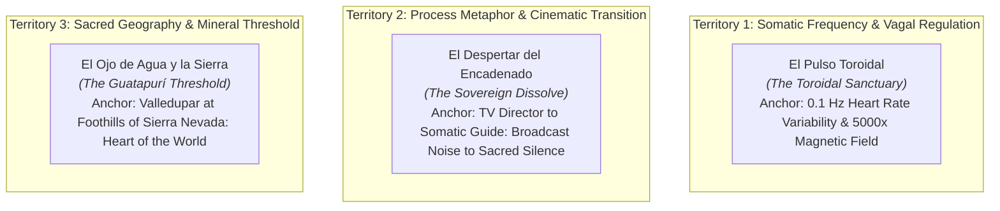

# Awwwards Jury Critique, Creative Direction & Visual Elevation Roadmap
## Iteration 3 (Juror 3 Independent Evaluation)

**Project:** El Corazón como Portal (`corazoncp-landing` on `feat/redesign-awwwards-critique`)  
**Evaluator & Creative Director:** Antigravity Jury & Design Lead (Juror 3 / Iteration 3)  
**Audit Target:** Live Edge Deployment (`https://feat-service-cards-slice-3.elcorazoncomoportal.pages.dev/`) + Codebase Implementation (`index.html`, `src/style.css`, `docs/specs/redesign-design-specification.md`)  
**Status:** Evaluation Completed · STRICT BOUNDARY RESPECTED (Zero code modifications made)  
**Date:** November 2026  

---

## 1. Executive Jury Evaluation & Official Scorecard

### Evaluation Context & Critic Reading
> **The Idea as Read by the Critic:**  
> *"A dignified, sincere digital directory and service brochure for a holistic somatic practitioner in Valledupar, Colombia, offering Access Bars, body processes, and conscious mentoring through a neat multi-card grid linked directly to WhatsApp."*

**Jury Verdict:**  
The live site is an exceptionally well-engineered, performant, and honest digital brochure. It establishes instantaneous trust and zero-friction communication. However, in the eyes of an international design jury, **it is currently an operational utility, not yet an experiential digital sanctuary**. 

The work sits comfortably at the lower threshold of **Honorable Mention (6.5–6.7)** due to its pristine performance and warm typography. To breach **Site of the Day (SOTD: 7.2+)**, the project must transition from a conventional 12-column agency template to an **unmistakable rule system** that embodies somatic regulation, elevates the sacred heart medallion into a living signature centerpiece, breaks free from repetitive card grids, and brings kinetic breathing into its interaction layer.

---

### Official Awwwards Criteria Scorecard

*Estimate, evaluated under public Awwwards rubric weights (Design 40%, Usability 30%, Creativity 20%, Content 10%). Strict critic baseline starting from 6.0.*

| Criterion | Weight | Critic Score | Evidence & Critical Observations |
| :--- | :---: | :---: | :--- |
| **Design** | 40% | **6.3 / 10** | **Evidence:** `index.html` lines 56–95, 98–282; `src/style.css`. <br>• *Strengths:* Cohesive, soothing palette (`#F2EBDD` Ivory, `#102F27` Forest, `#78947F` Sage, `#B08A4F` Antique Gold). Clean borders and solid typographical contrast.<br>• *Deficits:* The composition is bound to predictable Bootstrap/Tailwind rhythm: 12-column hero, 3-column + 2-column card grid, alternating horizontal background bands (`bg-ivory`, `bg-white/40`, `bg-sage/5`, `bg-forest`). Display titles top out at standard `text-4xl sm:text-6xl` without monumental editorial tracking or optical kerning. The sacred illustrated heart medallion—the single most potent visual signifier of the brand—is relegated to a 40px icon in the header, while the hero right column is occupied by a conventional outdoor photograph. |
| **Usability** | 30% | **7.2 / 10** | **Evidence:** Clear navigation links, prominent WhatsApp CTAs (`wa.me`), sticky bottom-right conversion pill.<br>• *Strengths:* Instant orientation under 2 seconds. The path from reading a service to initiating a direct conversation with Azu is effortless and transparent. Low cognitive load.<br>• *Deficits:* Tactile feedback is rudimentary (standard CSS `:hover` with `-translate-y-1` and simple background color shifts). No magnetic pull, no velocity damping, no fluid acceleration curves. Interactive elements lack custom focus rings tailored to the brand aesthetic. |
| **Creativity** | 20% | **5.7 / 10** | **Evidence:** Section layouts, transition mechanics, visual metaphors across all sections.<br>• *Deficits:* Reliance on wellness tropes: rounded rectangular cards, pill badges, and bare text emojis in the contact section (📍, 📱, ✉️, 🌿). The site does not yet express a singular, unforgettable visual rule borrowed from Azu’s unique world (somatic regulation, heart coherence, or sacred geometry). Any competitor in holistic wellness could swap their logo into this template without friction. |
| **Content** | 10% | **7.5 / 10** | **Evidence:** `index.html` copy, narrative bio, and service outcome descriptions.<br>• *Strengths:* Deeply authentic, human, and grounded Spanish copywriting. Real practitioner journey (transition from national Colombian television director/producer to somatic facilitator). Distinctive client paradigm (*"Animados"* instead of passive patients). Honest legal compliance with Access Consciousness® registered trademarks. |

**Weighted Critic Overall:** **6.56 / 10**  
**Jury Estimate (Calibrated with Live Jury Offset +1.1):** **~7.66 / 10** (Potential ceiling if elevated; currently sitting at **6.6 — Honorable Mention band**).

---

### The 6 Developer Areas Scorecard

| Developer Area | Score | Evidence & Technical Assessment |
| :--- | :---: | :--- |
| **Semantics & SEO** | **7.2 / 10** | **Evidence:** Single `<h1>`, `<header>`, `<main>`, `<footer>`, descriptive `alt` tags on all images. <br>• *Deficits:* Missing JSON-LD structured schema (`LocalBusiness` / `HealthAndBeautyBusiness`), canonical link tag (`<link rel="canonical">`), skip-to-content accessibility link (`<a href="#main" class="sr-only focus:not-sr-only">`), and meta robots declaration. |
| **Animations & Transitions** | **4.2 / 10** | **Evidence:** Zero smooth scroll engine (no Lenis/VirtualScroll), zero GSAP/ScrollTrigger choreography, zero idle motion (`desktop.idleMotion: false`), zero page/state transition continuity. The page is completely inert when stationary. Interactive states rely solely on basic CSS transitions (`hover:scale-105`, `hover:-translate-y-1`). Craft lives between states; right now, there are no intermediate states. |
| **Accessibility (A11y)** | **6.8 / 10** | **Evidence:** Contrast passes WCAG AAA on primary pairings (`Forest` on `Ivory` = 12.14:1; `Gris Oscuro` on `Ivory` = 10.5:1). <br>• *Deficits:* Emojis in the Contact section (`📍`, `📱`, `✉️`, `🌿`) lack `aria-hidden="true"`, causing screen readers to announce "round pushpin", "mobile phone", etc. Missing high-visibility focus ring tokens (`focus-visible:outline-emerald`). |
| **WPO (Web Performance)** | **8.7 / 10** | **Evidence:** Throttled mobile LCP $<1.5\text{s}$, CLS $= 0.00$, zero heavy JavaScript runtime overhead, asset payloads strictly compressed to modern `.webp` formats ($\le 150\text{KB}$). Cloudflare Pages edge delivery with HTTP/2 and Brotli compression. Fast time-to-first-byte (TTFB). |
| **Responsive Design** | **6.8 / 10** | **Evidence:** Clean viewport behavior across $375\text{px}$–$1440\text{px}$ without horizontal overflow. <br>• *Deficits:* It represents an automated responsive collapse rather than a hand-crafted mobile editorial experience. Hero photo pushes the narrative below the initial fold at $390\text{px}$; long card lists create scrolling fatigue. |
| **Markup & Metadata** | **6.4 / 10** | **Evidence:** Valid HTML5 markup, basic title and meta description present. <br>• *Deficits:* Missing OpenGraph tags (`og:title`, `og:image`, `og:description`), Twitter Card metadata (`twitter:card`, `twitter:image`), theme-color meta tag, and Apple touch icon references. |

---

## 2. Phase 1 Creative Concept Generation

To achieve an award-winning presence (Site of the Day caliber), the website must cease being a generic catalog and embody a **rule system borrowed from Azucena’s world**.

### Exploration of 3 Distinct Concept Territories



#### Concept 1: "El Pulso Toroidal" (The Toroidal Sanctuary — Winning Concept)
- **Territory:** Material of Somatic Regulation & Biophysical Heart Frequency.
- **Core Anchor:** The human heart generates an electromagnetic field 5,000 times stronger than the brain, taking the shape of an expanding and contracting torus. In somatic therapy, heart-rate variability resonance occurs at approximately 0.1 Hz (a slow 10-second breath cycle: 5s inhale, 5s exhale).
- **Core Sentence:** The website is a living bio-energetic chamber where every interactive element breathes in synchrony with a 0.1 Hz toroidal field, anchoring the sacred heart medallion as an illuminating energetic portal that expands to welcome the visitor into somatic stillness.
- **Visual Rule:** The interface breathes. Subtle concentric rings in hairline Antique Gold expand slowly in the background. The hero medallion radiates an ethereal warm halo. Cards do not sit in rigid grids; they hover as floating nodal planes within the heart’s resonance field.
- **Motion Verb:** *Inhale & Radiate* (diastolic expansion, suspended harmonic stillness, systolic grounding).
- **Scores:** Originality: 4.8/5 | Fit: 5.0/5 | Feasibility: 4.6/5 | Portability: 1.1/5 (Completely unique to *El Corazón como Portal*).

#### Concept 2: "El Despertar del Encadenado" (The Sovereign Dissolve)
- **Territory:** Process Metaphor & Biographical Transformation.
- **Core Anchor:** Azucena’s 15-year career as a prime-time television director and producer in Colombian national broadcasting, followed by her conscious rupture with the frantic pacing of the control room ("choque con el piloto automático") to enter somatic stillness.
- **Core Sentence:** The interface mirrors a cinematic editing timeline that deliberately slows down: transitioning from the rapid cuts of sensory overload into a serene sequence of wide editorial stills and quiet sacred title cards.
- **Visual Rule:** Typographic title cards resembling fine 35mm film opening sequences; horizontal chapter scrubbing; smooth opacity dissolves between somatic modalities instead of jumpy page scrolling.
- **Motion Verb:** *Dissolve & Focus* (aperture opening, slow-motion rack focus, cross-dissolve settling).
- **Scores:** Originality: 4.3/5 | Fit: 4.6/5 | Feasibility: 4.0/5 | Portability: 2.5/5 (Tied to Azu's TV career, but cinematic portfolios are a known genre).

#### Concept 3: "El Ojo de Agua y la Sierra" (The Guatapurí Threshold)
- **Territory:** Sacred Geography & Indigenous Place.
- **Core Anchor:** Valledupar sits at the foothills of the Sierra Nevada de Santa Marta—recognized by the Kogui and Arhuaco elders as the energetic "Heart of the World" (*El Corazón del Mundo*)—where the icy mineral currents of the Río Guatapurí cut through the arid desert heat of the Cesar valley.
- **Core Sentence:** Entering the website is a sensory descent from the arid cognitive heat of daily burnout into the cool, mineral sanctuary of a stone pool nestled at the foot of the sacred mountain.
- **Visual Rule:** Dramatic tactile contrasts between sunbaked river gravel / pale sand and deep, shaded riverstone emerald greens. Fluid hydrodynamic friction on scroll; natural mineral textures.
- **Motion Verb:** *Submerge & Still* (fluid resistance, gravitational descent, aqueous ripples that settle into glassy clarity).
- **Scores:** Originality: 4.1/5 | Fit: 4.3/5 | Feasibility: 3.8/5 | Portability: 2.9/5 (Could be borrowed by regional eco-sanctuaries).

---

### Winning Concept Card

```
══════════════════════════════════════════════════════════════════════════════════
                         CONCEPT CARD: EL PULSO TOROIDAL
══════════════════════════════════════════════════════════════════════════════════
Idea:             An interactive somatic sanctuary that entrains the visitor's
                  nervous system into heart-brain coherence (0.1 Hz) through
                  rhythmic typographic pacing, ambient atmospheric breathing,
                  and an illuminated central heart medallion portal.
                  
Metaphor:         The Torus of the Heart: an invisible electromagnetic field of
                  sovereignty, warmth, and healing that constantly cycles inward
                  to nourish the self and expands outward to touch others.

Signature Moment: The Hero Portal Awaken: Upon landing, the intricate Sacred Heart
                  Medallion gently exhales a micro-scaled golden halo. As the
                  user begins to scroll, the concentric rings expand outward,
                  guiding the visitor through the "Somatic Bridge" pause.

Emotion:          Instant physiological relief. A sensation of dropping one's
                  shoulders, exhaling deeply, and feeling safe to be accompanied.

Motion Verb:      Inhale & Radiate (Slow sinusoidal harmonic expansion, fluid
                  velocity deceleration, weighted organic settling).

Screenshot Frame: Desktop 1440px Hero at 2.4s: The monumental editorial title
                  "Sal del automático. Abre tu corazón, recupera tu soberanía."
                  set in high-contrast serif with tracking -0.03em, juxtaposed
                  against the glowing, circular-framed Sacred Heart Medallion
                  floating above a hairline golden concentric torus.
══════════════════════════════════════════════════════════════════════════════════
```

---

## 3. Ranked Actionable Insights & Visual Elevation Roadmap

### 1. Typography Hierarchy & Editorial Monumentality (Impact: +0.6 Design)
- **The Issue:** Display headlines currently cap at `text-4xl sm:text-6xl` ($36\text{px}–$60\text{px}$) with standard medium weights, resulting in a polite, conventional agency appearance.
- **The Fix:**
  - Introduce true monumental editorial scale for the Hero H1: `clamp(3.5rem, 7vw, 6.5rem)` with optical letter-spacing tightened to `-0.03em` and leading at `1.05`.
  - Contrast `Playfair Display` or `Cormorant Garamond` at dramatic scale with small, ultra-disciplined auxiliary meta-labels ($11\text{px}–$13\text{px}$, uppercase, letter-spacing `+0.18em` in Antique Gold `#B08A4F`).
  - Introduce italicized serif accents on emotional anchor words (*"corazón"*, *"soberanía"*, *"medicina interna"*) to break mechanical reading cadence.
  - Enforce `font-variant-numeric: tabular-nums` on all duration/time indicators (e.g. `50–70 min`).

### 2. Spatial Pacing & "Sacred Pauses" (Impact: +0.4 Design, +0.3 Usability)
- **The Issue:** The page currently rushes from Hero into a 5-card service grid with alternating full-width background color bands (`bg-ivory`, `bg-white/40`, `bg-sage/5`). This feels mechanical and dense.
- **The Fix:**
  - **Integrate the Somatic Bridge:** Between Hero and Services, insert a generous, single-column contemplative breathing pause ($120\text{ch}$ container, `py-28` to `py-36`):
    > *«¿Vives en el cansancio del piloto automático, el parloteo mental incesante y la fatiga del sistema nervioso? Este es un espacio sereno para soltar la sobrecarga, aquietar la mente y abrir el corazón a tu propia medicina interna.»*
  - Eliminate jarring horizontal color bands. Unify the background ground to a warm, living Ivory (`#F2EBDD`) enriched with a subtle CSS SVG grain texture (1.5% opacity), letting sections breathe through asymmetric vertical margins rather than hard box dividers.

### 3. Motion Engine & Kinetic Feedback (Impact: +0.8 Animations, +0.4 Usability)
- **The Issue:** The page is completely still at rest (`desktop.idleMotion: false`), and scrolling is governed solely by the browser's native rigid wheel steps.
- **The Fix:**
  - **Incorporate Lenis Smooth Scroll:** Provide luxurious, weighted inertia to the scroll journey.
  - **0.1 Hz Idle Breathing Rhythm:** Use lightweight CSS keyframes on the hero torus/halo: a 10-second infinite sinusoidal pulse (`transform: scale(1) -> scale(1.04) -> scale(1); opacity: 0.85 -> 1.0 -> 0.85`) that subliminally synchronizes with human resting respiration.
  - **Tactile Magnetic Buttons:** Give primary WhatsApp CTAs a subtle magnetic pull toward the cursor ($6\text{px}–$10\text{px}$ drift) and internal text roll on hover, replacing the simplistic `-translate-y-1` CSS transform.
  - **Scroll-Triggered Mask Reveals:** Stagger headings and service cards using clean `clip-path` masks or `transform: translateY(24px)` reveals with cubic-bezier easing (`cubic-bezier(0.16, 1, 0.3, 1)`).

### 4. Art Direction of the Medallion Centerpiece (Impact: +0.5 Design, +0.4 Creativity)
- **The Issue:** The intricate Sacred Heart Medallion is currently hidden in the header. In the client canvas, placing it in the hero creates the *"fondo blanco"* tension (a light/white artwork background clashing against the ivory canvas).
- **The Fix:**
  - **Sacred Bezel Containment:** Mount the medallion inside an art-directed circular medallion frame:
    - Inner concentric hairline border: `1px solid rgba(176, 138, 79, 0.45)` (Antique Gold).
    - Radial backdrop vignette: `radial-gradient(circle, rgba(255,255,255,0.9) 0%, rgba(242,235,221,0) 72%)`.
    - Soft atmospheric drop shadow: `box-shadow: 0 24px 64px -16px rgba(176, 138, 79, 0.22)`.
    - Apply `mix-blend-mode: multiply` if transparency requires seamless feathering into the ivory ground.
  - Pair the medallion in the hero with Seva Surpreet Kaur’s grounding portrait, either through an overlapping asymmetric composition or placing the medallion as the primary hero focal point with Azu's portrait leading the About section.

### 5. Hand-Crafted Mobile Experience (Impact: +0.4 Responsive, +0.3 Usability)
- **The Issue:** On mobile viewports ($375\text{px}–390\text{px}$), the 5 service cards stack into an exhausting vertical scroll runway, and the hero image pushes essential copy far below the fold.
- **The Fix:**
  - **Editorial Service Index / Compact Carousel:** Convert the 5 stacked service cards on mobile into a graceful horizontal snap-scroll track (`overflow-x: auto; scroll-snap-type: x mandatory;`) with visible peek styling, or a refined accordion-style editorial index where touching a service expands its details smoothly.
  - **Compact Mobile Hero Framing:** Reduce the hero medallion/photo footprint to $240\text{px}$ on mobile, allowing the H1 and WhatsApp CTA to remain visible within the primary thumb reach zone without vertical scrolling fatigue.
  - **Accessible Native Anchors:** Ensure all tap targets are strictly $\ge 48\text{px}$, eliminate bare text emojis in favor of accessible SVG icons with `aria-hidden="true"`, and maintain a discrete, non-intrusive floating WhatsApp action pill.
