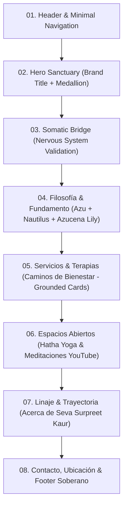

# Comprehensive Visual Design Specification & Art Direction
**Project:** El Corazón como Portal (`corazoncp-landing`)  
**Role:** Senior UX Architect, Art Director & Visual Design Consultant  
**Status:** Canonical Design Specification (Derived from Slice 3 & Client Canvas)  
**Date:** November 2026  

---

## 1. Executive Summary & Canvas Assessment

### 1.1 Canvas Evaluation & Critical Findings
The client's evolving design canvas introduces significant conceptual breakthroughs while presenting key execution tensions that must be resolved:

1. **Restoration of Brand Centerpiece (The Illustrated Medallion):**
   - *Previous state:* The intricate illustrated heart medallion (all-seeing eye, phoenix, golden flame, botanical wreath) was relegated to a 40px icon in the header, while a lifestyle photograph occupied the hero.
   - *Canvas breakthrough:* The canvas places the medallion prominently in the Hero right column. This immediately establishes sacred atmosphere, artistic sovereignty, and brand differentiation from generic clinical or SaaS wellness sites.
   - *The "Fondo Blanco" Tension:* The client explicitly annotated: *"algo se debe decir que tiene fondo blanco"*. The raw artwork has a light/white background. Placing a stark white rectangle or unfeathered circle directly onto the warm Ivory (`#F2EBDD`) canvas creates an unstyled "sticker" artifact.
   - *Resolution:* The medallion must be treated as a sacred editorial medallion: framed by an ultra-delicate concentric antique gold bezel (`#B08A4F`), nestled inside a soft, warm radial vignette with subtle drop illumination (`box-shadow: 0 20px 48px -12px rgba(176, 138, 79, 0.18)`), or processed with CSS multiply blending against the warm ivory ground.

2. **Introduction of the Somatic Bridge:**
   - *Canvas breakthrough:* The transition between Hero and offerings now features a contemplative bridge:
     > *"¿Vives en el cansancio del piloto automático, el parloteo mental incesante y la fatiga del sistema nervioso? Este es un espacio sereno para soltar la sobrecarga, aquietar la mente y abrir el corazón a tu propia medicina interna."*
   - *Impact:* This creates a vital physiological pause. It validates the user's nervous system state before presenting modalities, elevating the site from transactional commercialism to compassionate accompaniment.

3. **Philosophy Section & Symbolism Integration:**
   - *Canvas breakthrough:* A dedicated sanctuary section uniting Azu's warm presence, the core axiom (*"En tu cuerpo, mente y energía reside la medicina para sanarte."*), and two sacred line art symbols:
     - The **Nautilus / Golden Spiral** (sacred geometry, organic unfolding, somatic presence).
     - The **Azucena Lily** (etymological root of Azucena: purity, safe harbor, blooming).
   - *Execution Caution:* The sketch places all elements horizontally (Nautilus + Portrait + Quote + Body + Lily). Without disciplined scale and hierarchy, this risks visual clutter. The symbols must function as ethereal background watermarks (15–20% opacity in Antique Gold or Sage), allowing Azu's portrait and the editorial typography to lead.

4. **The Services Architectural Divergence (Photo Strip vs. Editorial Cards):**
   - *The Conflict:* The canvas shows two conflicting directions:
     - *Direction A (Bottom-left):* Full-bleed photographic cards with text overlaid directly on images.
     - *Direction B (Top-left reference):* Deep olive green container (`SERVICES DESIGNED TO SUPPORT YOUR MIND, BODY, AND SOUL`) with numbered cards `01`, `02`, `03`, `04`, structured typography, minimalist iconography, and crisp borders.
   - *Art Direction Verdict:* Direction A compromises contrast, creates legibility failures across mobile viewports, and feels like generic stock imagery. Direction B provides superior clarity, grounding, and prestige.
   - *Recommended Synthesis:* An editorial hybrid. Retain the high-contrast grounded container and structured numbering/typography of Direction B, while integrating warm, art-directed photography into dedicated upper aspect windows within each card, preserving both human warmth and impeccable hierarchy.

---

## 2. Creative Direction & Emotional Character

### 2.1 Aesthetic Philosophy
The visual identity of *El Corazón como Portal* is rooted in **Sacred Editorial Grounding**. It merges the tactile, contemplative elegance of fine editorial publishing with the grounded warmth of somatic healing.

- **Atmosphere:** Warm, serene, spacious, and dignified. It evokes the feeling of walking into a sunlit sanctuary of natural wood, raw linen, botanical herbs, and quiet reflection.
- **Tone of Voice:** Compassionate authority. Azu is neither a clinical physician nor an ethereal mystic detached from reality; she is a sovereign guide (*Facilitadora de bienestar*) walking alongside the participant (*Animado*).
- **Visual Restraint:** Visual richness comes from the deliberate contrast between intricate brand art (the heart medallion, sacred line drawings) and generous, quiet negative space. We never use gratuitous floating shapes, generic wavy SVG dividers, or noisy gradients.

---

## 3. Layout Specification & Spatial Composition

### 3.1 Container System & Global Grid
- **Maximum Container Width:** $1200\text{px}$ (`max-w-6xl`) for standard content containers; $1360\text{px}$ for wide visual bands.
- **Reading Measure (Line Length):** $55\text{ch}$ to $68\text{ch}$ for long-form narrative text, guaranteeing effortless ocular tracking without fatigue.
- **Vertical Spacing Rhythm:**
  - Section vertical padding: $96\text{px}$ to $128\text{px}$ on desktop (`py-24` to `py-32`); $64\text{px}$ to $80\text{px}$ on mobile (`py-16` to `py-20`).
  - Inter-component gaps: $32\text{px}$ to $48\text{px}$ (`gap-8` to `gap-12`).
  - Text block margins: $16\text{px}$ to $24\text{px}$ (`mb-4` to `mb-6`).

### 3.2 Sequential Section Breakdown



#### Section 01: Header & Navigation
- **Height:** $76\text{px}$ fixed, sticky top.
- **Background:** `rgba(242, 235, 221, 0.92)` (`bg-ivory/92`) with `backdrop-blur-md` and bottom border `1px solid rgba(120, 148, 127, 0.25)` (`border-sage/25`).
- **Composition:**
  - Left: Sacred geometry icon ($36\text{px} \times 36\text{px}$) + Brand Wordmark (`Playfair Display`, $18\text{px}$, letter-spacing $+0.05\text{em}$, uppercase, color `Forest`).
  - Right: Accessible semantic menu (Servicios, Filosofía, Acerca de Azu, Contacto) with subtle hover state transitioning to `Emerald`.

#### Section 02: Hero Sanctuary (Split 55/45)
- **Grid:** 12-column grid. Left content: 7 columns ($58\%$). Right medallion: 5 columns ($42\%$).
- **Left Column Hierarchy:**
  - *Eyebrow:* `ACOMPAÑAMIENTO CONSCIENTE · VALLEDUPAR & ONLINE` (Font: `Raleway`, $12\text{px}$, bold, uppercase, tracking $+0.15\text{em}$, color `Antique Gold`).
  - *H1 Display Title:* `Playfair Display`, $56\text{px}$ (mobile: $38\text{px}$), line-height $1.15$, color `Forest`.
    *"Sal del automático. Abre tu corazón, recupera tu soberanía."*
  - *Supporting Narrative:* `Raleway`, $18\text{px}$, line-height $1.65$, color `Gris Oscuro` / `Forest` at $90\%$ opacity. Max-width $520\text{px}$.
  - *Action Block:* Primary WhatsApp CTA button + auxiliary micro-copy (*"Respuesta personalizada en menos de 24 horas"*).
- **Right Column Composition:**
  - The Sacred Heart Medallion.
  - Diameter: $440\text{px} \times 440\text{px}$ on desktop (scaled to $300\text{px} \times 300\text{px}$ on mobile).
  - Framed within a soft circular containment bezel:
    - Outer ring: $1\text{px}$ stroke `rgba(176, 138, 79, 0.35)` (`Antique Gold`).
    - Inner halo: Radial wash transitioning from `#FFFFFF` (behind artwork) to `#F7F2E8` at outer edge, blending smoothly into the `#F2EBDD` canvas.
    - Subtle shadow: `0 24px 48px -12px rgba(16, 47, 39, 0.08)`.

#### Section 03: The Somatic Bridge (Nervous System Validation)
- **Container:** Narrow centered reading container ($780\text{px}$ max-width).
- **Atmosphere:** Generous vertical padding ($96\text{px}$ top and bottom).
- **Typography:**
  - Quote text: `Cormorant Garamond` (Italic, weight 400, $28\text{px}$ desktop / $22\text{px}$ mobile, line-height $1.5$).
  - Color: `Forest` (`#102F27`).
- **Ornamentation:** Centered minimal antique gold anchor rule ($48\text{px} \times 1\text{px}$) with a tiny diamond or lotus glyph at center.

#### Section 04: Filosofía & Fundamento (Somatic Foundation)
- **Layout:** Three-zone horizontal harmony:
  - *Left Wing:* Fibonacci Nautilus line art ($180\text{px}$ wide, color `Antique Gold` at $20\%$ opacity, positioned organically).
  - *Center Focus:* Authentic portrait of Azu (`azu-about.jpg` / outdoor natural light), $340\text{px} \times 420\text{px}$, soft organic border radius ($24\text{px}$), subtle warm shadow.
  - *Right Editorial Stack:*
    - Core Axiom (H2): `Playfair Display`, $32\text{px}$, color `Forest`:
      *“En tu cuerpo, mente y energía reside la medicina para sanarte.”*
    - Narrative prose: `Raleway`, $16\text{px}$, line-height $1.75$, color `Gris Oscuro`.
    - Safe Harbor anchor badge (*"Espacio de acompañamiento presencial y a distancia"*).
  - *Right Wing Accent:* Azucena Lily botanical line art watermark ($160\text{px}$ wide, color `Sage` at $25\%$ opacity).

#### Section 05: Caminos de Bienestar (Services & Therapies)
- **Container Background:** Deep grounding canvas shift: Rich Forest (`#102F27`) or Porcelain Mist (`#F4F1EA`) with dark accent cards.
- **Recommended Theme:** Deep Grounding Forest Section (`bg-[#102F27]`) to honor the reference card system in the client's sketch:
  - Eyebrow: `CAMINOS DE BIENESTAR` (`Antique Gold`, $12\text{px}$, tracking $+0.15\text{em}$).
  - Section Header: `Servicios & Terapias` (`Playfair Display`, $42\text{px}$, `Ivory`).
  - Section Subtitle: *"Procesos conscientes diseñados para disipar el estrés, aliviar la carga somática y despertar tu soberanía interior."*
- **Grid Architecture:** 3-column / 2-column balanced grid ($5$ canonical services):
  - Card 1: `01 · Mentorías y Oidaterapia` (Online & Presencial)
  - Card 2: `02 · Clases de Kundalini Yoga` (Presencial & Grupal)
  - Card 3: `03 · Terapias Energéticas (Barras de Access®)` (Presencial)
  - Card 4: `04 · Procesos de Cuerpo` (Presencial Somático)
  - Card 5: `05 · Meditaciones Personalizadas` (Audio Asíncrono / Remoto)

---

## 4. Visual Design System

### 4.1 Color Palette & Contrast Validation

| Token Name | Hex Code | Role in Interface | Contrast on Ivory (`#F2EBDD`) | Contrast on Forest (`#102F27`) | WCAG 2.1 Compliance |
| :--- | :--- | :--- | :--- | :--- | :--- |
| **Ivory** | `#F2EBDD` | Primary Canvas & Light Ground | Baseline (1.0:1) | **12.14:1** | AAA (Background) |
| **Porcelain Mist** | `#F4F1EA` | Secondary Light Card Background | Soft tone layer | **12.92:1** | AAA (Card Canvas) |
| **Forest** | `#102F27` | Primary Dark Ground, H1/H2 Headings | **12.14:1** | Baseline (1.0:1) | AAA (Maximum Readability) |
| **Gris Oscuro** | `#303030` | Dense Body Copy & Explanatory Prose | **10.50:1** | **1.15:1** (Use Ivory on dark) | AAA (Body Text) |
| **Emerald** | `#185844` | Interactive CTAs, Conversion Buttons | **7.03:1** | **1.72:1** (Use as border/badge) | AAA (Primary Action) |
| **Sage** | `#78947F` | Subtle Dividers, Inactive Icons, Badges | **2.62:1** (Decorative) | **4.63:1** (Text AA) | AA on dark surfaces |
| **Antique Gold** | `#B08A4F` | Eyebrows, Bezel Borders, Sacred Geometry | **3.56:1** (Large text/rules) | **3.41:1** (Accents) | Editorial Highlight |
| **Pure White** | `#FFFFFF` | Medallion Core Backing, Focus Rings | **1.14:1** (Blend target) | **13.88:1** | AAA Highlight |

### 4.2 Typographic Hierarchy (Google Fonts OFL)

```
[Playfair Display 700]  H1 Hero Display (56px / 1.15)
        │
[Playfair Display 600]  H2 Section Entrances (36px–42px / 1.25)
        │
[Cormorant Garamond 600] H3 Service & Editorial Titles (24px–28px / 1.3)
        │
[Cormorant Garamond 400 Italic] Meditative Quotes & Bridges (22px–28px / 1.45)
        │
[Raleway 500 / 600]     UI Buttons, Navigation & Badges (13px–15px / 1.2 / +0.1em tracking)
        │
[Raleway 400]           Body Text & Explanatory Prose (16px / 1.65 / Gris Oscuro)
        │
[Raleway 400]           Metadata, Footnotes & Microcopy (13px–14px / 1.5)
```

1. **`Playfair Display` (OFL):** Editorial gravitas. Used for the primary hero proclamation and major section boundaries.
2. **`Cormorant Garamond` (OFL):** Somatic warmth. Used for evocative quotes, card titles, and contemplative axioms.
3. **`Raleway` (OFL):** Pristine geometric clarity. Used for dense body text, list items, and interactive UI targets to eliminate legibility fatigue on mobile displays.

### 4.3 Spatial, Elevation & Border Radii Tokens
- **Borders:**
  - Card outlines: `1px solid rgba(120, 148, 127, 0.35)` on light surfaces; `1px solid rgba(176, 138, 79, 0.35)` on dark surfaces.
  - Accent dividers: `1px solid #B08A4F` (`Antique Gold`).
- **Radii:**
  - Small UI badges / Tags: `6px` (`rounded-md`).
  - Buttons & Interactive Pills: `9999px` (`rounded-full`).
  - Content Cards & Photo Frames: `20px` to `24px` (`rounded-2xl` to `rounded-3xl`).
  - Medallion Frame: `9999px` (perfect circle).
- **Shadows:**
  - Floating WhatsApp pill: `0 10px 25px -5px rgba(0, 0, 0, 0.25)`.
  - Service Cards: `0 12px 32px -8px rgba(16, 47, 39, 0.12)`.
  - Hero Medallion: `0 24px 60px -12px rgba(176, 138, 79, 0.2)`.

---

## 5. Component Specifications

### 5.1 The Sacred Heart Medallion Component
- **Purpose:** Serve as the visual anchor of the ecosystem, communicating sovereignty, inner alchemy, and the awakeness of the heart.
- **Construction & "Fondo Blanco" Solution:**
  1. **Container:** Circular aspect ratio ($1:1$), maximum diameter $440\text{px}$ on desktop.
  2. **Layer 1 (Atmospheric Base):** Soft radial background gradient:
     `radial-gradient(circle, #FFFFFF 0%, #FAF6EE 65%, #F2EBDD 100%)`.
  3. **Layer 2 (Asset Integration):** The illustrated artwork is centered with `object-contain`. If the asset contains a stark white border, apply `mix-blend-mode: multiply` against the warm parchment backing, eliminating the sharp perimeter seam.
  4. **Layer 3 (Sacred Bezel):** An overlay ring with `border: 1px solid rgba(176, 138, 79, 0.4)` and a delicate dashed outer perimeter ring ($6\text{px}$ gap) that references astronomical instruments and sacred geometry.

### 5.2 Grounded Service Card Component (Synthesis of Direction B)
- **Purpose:** Present individual therapeutic pathways with clarity, outcome focus, and dignity.
- **Visual Structure:**
  - **Header Row:**
    - Monospaced / Editorial Index Number: `01`, `02`, `03` in `Antique Gold` (`Raleway`, weight 600, $14\text{px}$).
    - Modality Tag: `Presencial` or `Online & Presencial` (`border border-sage/40 rounded-full px-2.5 py-0.5 text-xs`).
  - **Visual Window (Aspect 16:9):** A cropped, warm photograph of the practice (e.g. hands on head for Barras de Access, Kundalini kriya, peaceful tea/meditation) with subtle duotone tint or warm film grain.
  - **Body Content:**
    - Card Title (H3): `Cormorant Garamond`, weight 600, $24\text{px}$, high contrast.
    - Outcome Description: 2–3 sentences highlighting tangible relief (disolving autopilot, physical ease, nervous system regulation).
    - Trademark Compliance: Explicit `®` symbol on `Barras de Access®` with link to official directory.
  - **Action Row:**
    - Inline text link with animated arrow: `Conversar sobre esta sesión →` (`text-sm font-semibold text-emerald hover:text-forest`).

### 5.3 Philosophy Sanctuary Trio (Nautilus — Portrait — Azucena)
- **Purpose:** Humanize the brand, build somatic trust, and celebrate Azu's personal identity.
- **Visual Structure:**
  - A three-column fluid grid ($1:2:1$ visual weight ratio on desktop).
  - Left: Nautilus vector SVG watermark.
  - Center: Azu’s portrait with caption pill anchored at bottom left corner.
  - Right: Azucena lily flower line art SVG watermark.
- **Responsive Behavior:** On tablet and mobile, the watermarks gracefully transition into faint absolute background watermarks ($10\%$ opacity), allowing the photo and quote to occupy 100% width without cognitive clutter.

---

## 6. Interaction & Motion Specification

1. **Scroll-Driven Micro-Encounters:**
   - Elements do not aggressively fly across the screen. Motion is subtle, slow, and grounding ($\ge 600\text{ms}$ duration, `cubic-bezier(0.16, 1, 0.3, 1)` easing).
   - As the user scrolls into the Somatic Bridge, the text fades in with an opacity transition from $0$ to $1$ over $800\text{ms}$.

2. **Medallion Idle Breath:**
   - The outer antique gold bezel undergoes a continuous, ultra-slow rhythmic expansion (scale $1.00$ to $1.02$ over a $12\text{second}$ period, mimicking a slow yogic breath cycle).
   - *Accessibility Invariant:* Disabled when `prefers-reduced-motion: reduce` is detected.

3. **Service Card Hover State:**
   - Subtle vertical elevation: `transform: translateY(-4px)`.
   - Border transition from `rgba(120, 148, 127, 0.35)` to `#B08A4F` (`Antique Gold`).
   - Image scale: `scale-102` within the overflow-hidden aspect container over $400\text{ms}$.

4. **Floating WhatsApp Conversion Pill:**
   - Fixed position: `bottom-5 right-5 z-50`.
   - Hover: Expands scale to $1.05$, slight shadow elevation.
   - Active: Scale $0.95$ with immediate tactile feedback.

---

## 7. Responsive Specification (Breakpoints)

- **Mobile Viewport ($375\text{px}$ – $430\text{px}$):**
  - All grids collapse to single-column stacking.
  - Hero order: Eyebrow $\rightarrow$ H1 $\rightarrow$ Medallion ($280\text{px}$ diameter) $\rightarrow$ Supporting text $\rightarrow$ Primary CTA. (Placing the medallion directly under H1 establishes visual identity immediately on small screens).
  - Service cards stack vertically with $20\text{px}$ gap.
  - Touch target enforcement: Minimum $48\text{px} \times 48\text{px}$ for all buttons, anchor links, and close targets.
- **Tablet Viewport ($768\text{px}$ – $1024\text{px}$):**
  - Hero transitions to 2-column layout.
  - Service cards arrange in a $2$-column balanced layout.
  - Philosophy section stacks Azu's portrait above the quote, with watermarks subtly flanking the margins.
- **Desktop Viewport ($1280\text{px}$ – $1440\text{px}$):**
  - Full editorial split layouts with generous $96\text{px}$–$128\text{px}$ vertical margins.
  - Medallion scales to full $440\text{px}$ diameter.

---

## 8. Accessibility & Usability Invariants (WCAG 2.1 AA/AAA)

1. **Text Contrast:**
   - Headings (`Forest` on `Ivory`): **12.14:1** (Exceeds WCAG AAA requirement of 7.0:1).
   - Body copy (`Gris Oscuro` on `Ivory`): **10.50:1** (Exceeds WCAG AAA).
   - Card text on dark surfaces (`Ivory` on `Forest`): **12.14:1** (Exceeds WCAG AAA).
2. **Keyboard Focus Visibility:**
   - Interactive elements must exhibit a high-contrast focus ring: `outline: 2px solid #185844; outline-offset: 3px`.
3. **Screen Reader Semantic Tree:**
   - Medallion image: `alt="Emblema sagrado de El Corazón como Portal: corazón ilustrado con ojo avizor, ave fénix y ramas botánicas"`.
   - Headings adhere strictly to semantic sequence: Single `h1` in Hero, `h2` for section titles, `h3` for individual service titles.
4. **Cognitive Load & Legibility:**
   - No auto-playing video, sound, or rapid unprompted carousel rotation.
   - Text is never placed over busy photographic backgrounds without an opaque backing container or certified scrim.

---

## 9. Implementation Priorities

### Critical (Phase 1 — Core Structural Coherence)
1. **Hero Realignment:** Position the illustrated heart medallion in the Hero right column with the specified white-background containment bezel.
2. **Somatic Bridge Insertion:** Implement the contemplative bridge section between Hero and Philosophy/Services.
3. **Contrast & Typography System:** Lock the three approved Google Fonts (`Playfair Display`, `Cormorant Garamond`, `Raleway`) and verified color tokens across all sections.

### Important (Phase 2 — Section Enrichment)
4. **Service Card Hybridization:** Implement the grounded numbered card layout (Direction B synthesis) with dedicated photo windows and explicit WhatsApp routing.
5. **Philosophy Section Refinement:** Arrange Azu's portrait and quote with the Fibonacci Nautilus and Azucena Lily line art accents.
6. **Mobile Touch Target & Stacking Verification:** Validate single-column fluid stacking and $\ge 48\text{px}$ touch targets across all mobile devices.

### Optional (Phase 3 — Kinetic & Atmospheric Polish)
7. **Subtle Medallion Breathing Animation:** Implement the 12-second CSS breath cycle with reduced-motion media query guards.
8. **Asymmetrical Complementary Spaces:** Refine the 65/35 split between Hatha Yoga and YouTube open meditations.

---

## 10. Design Rationale & Architectural Decisions

1. **Why the Medallion Belongs in the Hero:**
   *El Corazón como Portal* is not an ordinary therapy directory; it is a sacred personal sanctuary. The illustrated heart medallion is the spiritual nucleus of Azu’s creation. By featuring it in the Hero, the visitor is greeted not with a generic stock photograph or a sterile corporate grid, but with an authentic piece of art that signals depth, contemplation, and soul.

2. **Why Direction B (Editorial Cards) Defeats Direction A (Photo Carousel):**
   Full-bleed photographic carousels with text overlays are a common design trap. They force white text over unpredictable photographic highlights, create accessibility failures for low-vision users, and hide 60% of offerings behind carousel navigation. By adopting Direction B's grounded, numbered card architecture with dedicated photographic windows, we achieve pristine readability, calm scannability, and high perceived value.

3. **Why the Somatic Bridge is Essential:**
   Users seeking wellness often arrive in a state of sensory overload or anxiety. Jumping directly from a slogan to a sales catalog triggers transactional evaluation. The Somatic Bridge honors the visitor's nervous system, creating an immediate felt experience of sanctuary.
