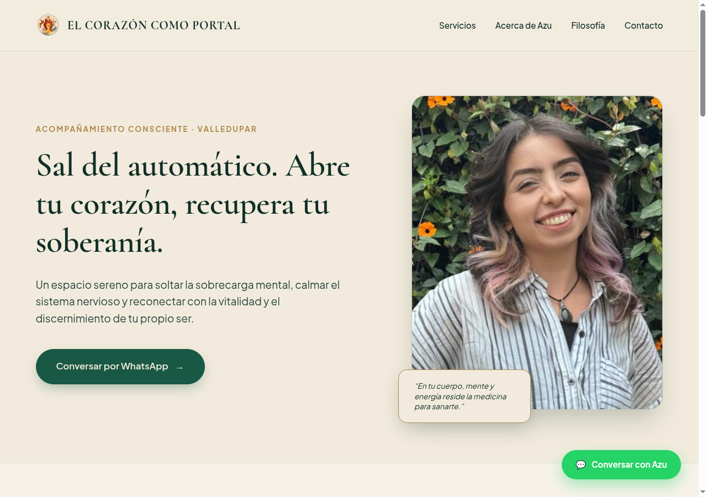
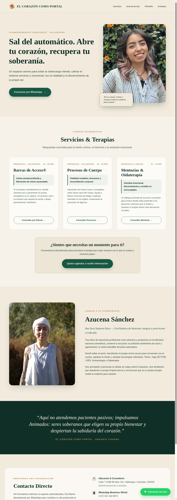
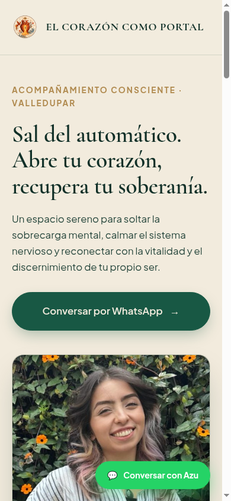
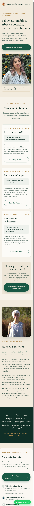

# Visual Canvas & Layout Specification — El Corazón como Portal

This document specifies the responsive layout architecture, design tokens, visual hierarchy, and asset guidelines for the **El Corazón como Portal** landing page (`corazoncp-landing`). It serves as the authoritative visual reference for engineering implementation, accessibility validation, and stakeholder alignment.

---

## 1. Architectural Principles & Layout Intent

The layout is engineered around an **outcome-first, mobile-centric conversion architecture**:
- **Mobile-First Orientation:** Discovery traffic predominantly originates from Instagram, YouTube, and WhatsApp channels (>80% projected mobile viewport share). The interface prioritizes touch ergonomics ($\ge 48\text{px}$ touch targets), single-column fluid stacking, zero horizontal overflow, and minimal cognitive friction.
- **Serene Editorial Aesthetic:** The visual rhythm pairs editorial typography (`Playfair Display`, `Cormorant Garamond`, `Raleway`) with warm earth tones, evoking calm, somatic presence, and personal grounding rather than transactional commercialism.
- **Frictionless Conversion Funnel:** Rather than requiring form fills or client account creation, every touchpoint routes directly into a 1:1 WhatsApp Business conversation with pre-populated contextual inquiry text.
- **Asset Discipline & Performance:** Every image must justify its byte weight and viewport footprint without causing visual saturation or degrading Largest Contentful Paint (LCP). Raw client assets must be transcoded and optimized prior to inclusion.

---

## 2. Desktop Viewport Specification (1440px Reference)

### 2.1 First Viewport & Hero Composition

The desktop layout establishes credibility and immediate emotional resonance upon landing:
- **Header:** Lightweight navigation bar with sacred geometry logo, brand title, and section anchor links (`#servicios`, `#acerca`, `#filosofia`, `#contacto`). Soft green tint wash (`verdecita` / translucent emerald wash) to enhance visual contrast against the canvas while maintaining backdrop blur. No login or registration links.
- **Hero Section:** Split-column composition:
  - **Left Column:** Dual-modality eyebrow badge (`ACOMPAÑAMIENTO CONSCIENTE · VALLEDUPAR & ONLINE`), editorial slogan headline (*"Sal del automático. Abre tu corazón, recupera tu soberanía."*), grounding symptom identification narrative (*"Acompañamiento integral para habitar tu cuerpo sin dolor, disipar el estrés, la ansiedad y el insomnio..."*), and the primary WhatsApp call to action.
  - **Right Column:** Seva Surpreet Kaur's natural lifestyle portrait (`azu-hero.jpg`), framed with soft organic border radius, subtle antique gold backdrop framing, and an enlarged quote caption for high readability.

### 2.2 Full-Page Sequential Hierarchy

The full desktop scroll follows seven clearly demarcated content blocks:

1. **Header & Navigation:** Persistent/accessible anchor navigation with soft green tint contrast.
2. **Hero Section:** Problem identification, dual-modality badge, and primary conversion hook.
3. **Servicios & Acompañamiento (5 Outcome-First Cards):**
   - *1. Mentorías y Oidaterapia (Online & Presencial)* — Sesión principal online/presencial, espacio de escucha profunda y discernimiento.
   - *2. Clases de Kundalini Yoga y Acompañamientos* — Vitalidad somática, respiración consciente y kriya (fotografía con turbante sagrado y manos en oración).
   - *3. Terapias Energéticas (Barras de Access®)* — Calma electromagnética, disipa carga mental y libera de creencias limitantes. Includes official registered trademark symbol (`®`) and authority link to [Access Consciousness®](https://www.accessconsciousness.com/bars).
   - *4. Procesos de Cuerpo* — Liberando dolor y ligereza; imposición somática no invasiva orientada al alivio físico y reconexión celular.
   - *5. Meditaciones Personalizadas* — Herramienta sonora asíncrona a la medida de tu estado emocional actual (situada en 5° lugar para armonía visual de la retícula).
4. **Caminos Complementarios (`EXPLORA OTROS ESPACIOS`):**
   - Asymmetric 65/35 composition separating bodily practice from open community media:
     - **Anchor Panel (65%):** Features landscape outdoor photography (`hatha-yoga.webp`), title `Clases de Hatha Yoga (Personalizadas y Grupales)`, grounding copy, and primary WhatsApp CTA `[ Conversar sobre Clases por WhatsApp → ]`.
     - **Quiet Panel (35%):** `Porcelain Mist` container with `Sage` border, eyebrow `RECURSOS ABIERTOS`, title `Luz en tu Camino`, concise copy (*«Meditaciones abiertas para encontrar calma y reconectar contigo a tu propio ritmo.»*), upcoming podcast notice, and secondary link `[ Explorar meditaciones → ]` to YouTube.
5. **Acerca de Seva Surpreet Kaur:**
   - Title: `Seva Surpreet Kaur — Facilitadora de bienestar`.
   - Authentic portrait with namasté hands (`IMG_1994.HEIC` $\rightarrow$ web-optimized).
   - Narrative recounting her journey from Colombian television production and the burnout of autopilot to studying Tantra, Yoga (RYT200 / Kundalini KRI), Humanology, Access Consciousness, and Oidaterapia.
6. **Filosofía ("Animados, no Pacientes"):**
   - Grounding banner with *«Conecta con tu guía interno»* (retiring the Anahata chakra term).
   - Core philosophy quote: *«Aquí no atendemos pacientes pasivos; impulsamos Animados: seres soberanos que eligen su propio bienestar y despiertan la sabiduría trascendental del corazón.»*
7. **Contacto & Redes:**
   - Verified physical location (`Calle 7 #19B-88 Apto 102, Valledupar` linked to Google Maps in new tab).
   - WhatsApp Business line (`+57 321 542 8972`).
   - Official Facebook Fanpage (`https://www.facebook.com/elcorazoncomoportal/`).
   - Social channels: Instagram, YouTube, X, and Email.
   - Floating WhatsApp quick-action button with $\ge 48\text{px}$ touch target.

---

## 3. Mobile Viewport Specification (390px Reference)

### 3.1 Mobile Viewport Behavior

Mobile optimization is the core design constraint for this interface:
- **Card Stacking:** Multi-column desktop grids gracefully collapse to full-width stacked cards with consistent $16\text{px}$–$24\text{px}$ horizontal gutters.
- **Touch Ergonomics:** All action buttons and interactive touch targets enforce a minimum height of $48\text{px}$ to prevent misclicks.
- **Floating Conversion Pill:** A persistent WhatsApp pill is anchored at the bottom right corner with high contrast, enabling immediate connection from any scroll depth.

### 3.2 Mobile First Viewport (Hero)

### 3.3 Mobile Scroll Sequence

---

## 4. Applied Design Tokens & Contrast Ratios

The brand identity employs an earthy, grounding palette designed to convey warmth, safety, and natural equilibrium:

| Token Name | Hex Code | Primary Role | Accessibility Contrast (WCAG 2.1 AA) |
| :--- | :--- | :--- | :--- |
| **Ivory** | `#F2EBDD` | Primary Canvas & Background | Baseline canvas |
| **Porcelain Mist** | `#F4F1EA` | Secondary Canvas / Soft Breathing Background for Cards | Soft Canvas tint |
| **Forest** | `#102F27` | Headings, High-Contrast Body & Dark Banners | **12.14:1** on Ivory (Passes AAA) |
| **Gris Oscuro** | `#303030` | Dense Body Text, Secondary Captions & Utility UI | **10.5:1** on Ivory (Passes AAA) |
| **Emerald** | `#185844` | Primary Action Buttons & Status Badges | **7.03:1** on Ivory (Passes AAA) |
| **Sage** | `#78947F` | Subtle Borders, Dividers & Meta Tags | Auxiliary accent & subtle borders |
| **Antique Gold**| `#B08A4F` | Eyebrow Badges, Decorative Highlights & Accents | **3.56:1** on Ivory (for large/bold text & decorative) |

### 4.1 Typography (Approved Stack — 100% Free Open-Source via Google Fonts)

- **Títulos Principales & Encabezados de Sección (H1 / H2):** `Playfair Display` (Weights: 600, 700). Classic editorial elegance and strong visual anchor for the Hero slogan and major section entrances (`#servicios`, `EXPLORA OTROS ESPACIOS`, `#acerca`, `#filosofia`).
- **Títulos de Tarjetas de Servicio (H3):** `Cormorant Garamond` (Weights: 500, 600). Warm, literary, serene presence for individual service cards.
- **Cuerpo de Texto y Botones (Body / UI):** `Raleway` (Weights: 400, 500, 600). Modern, crisp geometric sans-serif ensuring effortless readability in paragraphs, badges, metadata, and buttons across mobile screens.

---

## 5. Asset and Content Policy Invariants

> [!WARNING]
> **Asset Pipeline Blocker:** Raw client photos (`.CR3`, `.CR2`, `.HEIC`) in `.internal/img/photos/` are strictly blocked from direct production use due to massive file sizes ($>24\text{MB}$) and lack of universal browser decoding. They must be transcoded and compressed into web-optimized `.webp` assets ($\le 150\text{KB}$) before being referenced in markup.

1. **Photography Attribution & Context:**
   - The natural lifestyle portrait (`azu-hero.jpg`) is reserved for the Hero section.
   - Photography featuring sacred Kundalini attire (turban and white garments, `IMG_4305.CR3`) is strictly reserved for the Kundalini Yoga service section.
   - The bio portrait (`IMG_1994.HEIC`) is reserved for the `Seva Surpreet Kaur` about section.
2. **Trademark Invariants:**
   - The phrase **Barras de Access®** must retain its registered trademark symbol (`®`) on its initial heading mention, accompanied by an explicit authority hyperlink to the official [Access Consciousness®](https://www.accessconsciousness.com/bars) directory (`target="_blank" rel="noopener noreferrer"`).
3. **Contact Channels & Privacy:**
   - Only the verified WhatsApp Business line (`+57 321 542 8972` / `https://wa.me/573215428972`) may appear in public client-facing code.
   - Personal phone numbers, private intake submissions, and unapproved client PII are strictly excluded from the repository.
